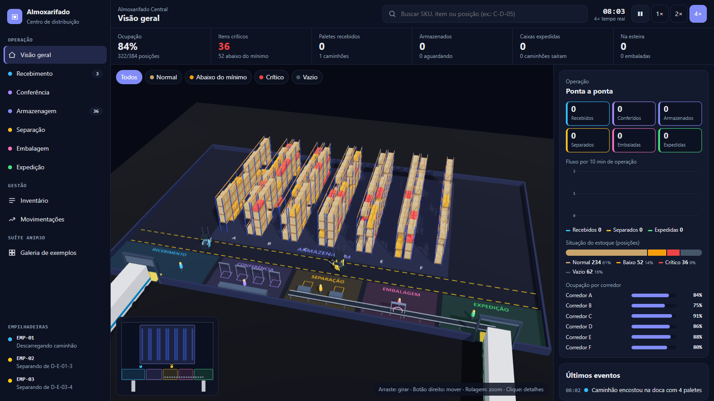
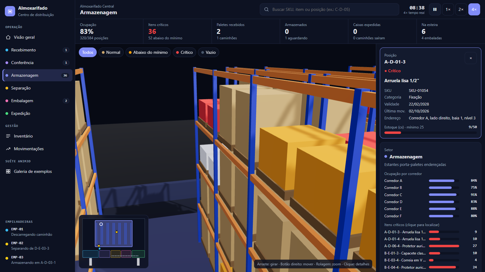
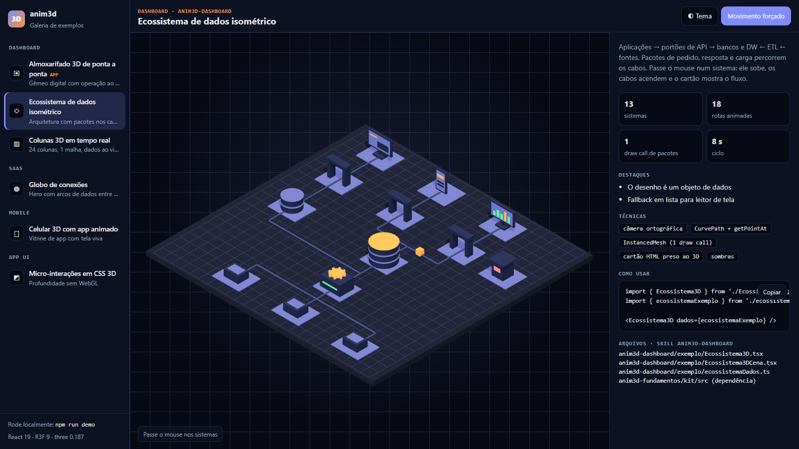
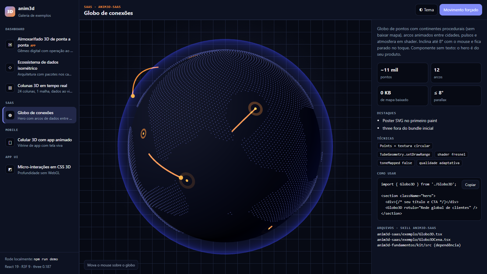
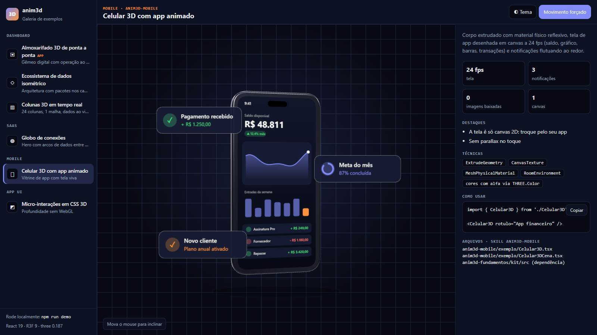
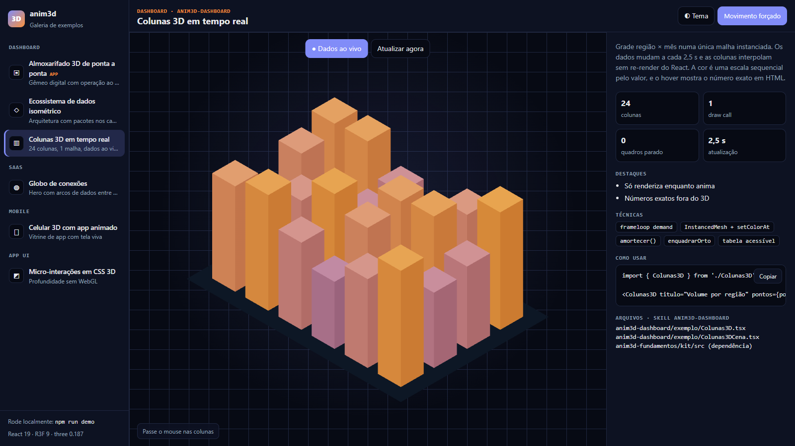
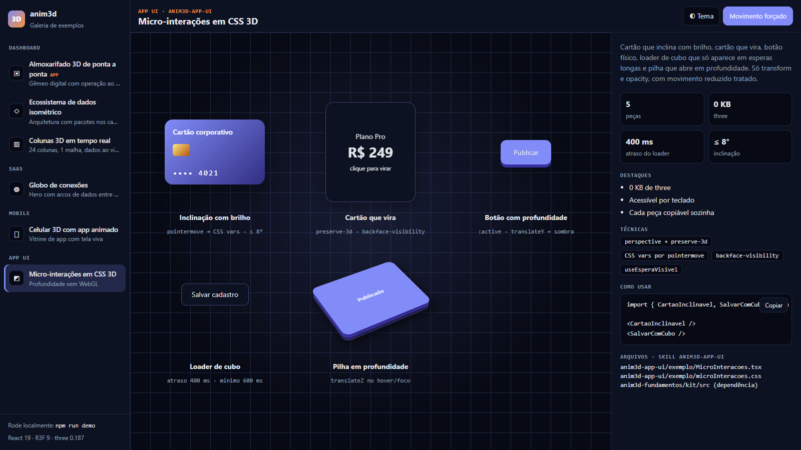

<div align="center">

# anim3d

**Suíte de skills para o Claude Code criar animações 3D de verdade em SaaS, dashboards, mobile e aplicações.**
Com kit de código testado, exemplos que rodam no navegador e verificação automática.




<sub>Almoxarifado 3D de ponta a ponta: um dos exemplos da suíte, simulado ao vivo no navegador.</sub>

</div>

---

## O que é

[Skills](https://docs.claude.com/en/docs/claude-code/skills) são pacotes de instruções que o Claude Code carrega quando a tarefa pede. Esta suíte ensina o Claude a **decidir se o 3D vale a pena**, escolher a tecnologia certa e entregar cenas **rápidas, acessíveis e verificadas**, em vez de um cubo girando que pesa 1 MB.

Ela tem três camadas:

| Camada | O que é |
|---|---|
| **Skills** (`anim3d-*/SKILL.md`) | Regras, orçamentos e armadilhas por contexto: SaaS, dashboard, mobile, UI, desempenho/acessibilidade e assets. |
| **Kit** (`anim3d-fundamentos/kit/`) | Utilitários TypeScript testados: carregamento sob demanda com fallback, tokens de cor, easing, enquadramento de câmera, qualidade adaptativa e perda de contexto. |
| **Exemplos** (`anim3d-*/exemplo/`) | Componentes reais, usados pela galeria e pelo app de demonstração. Copie e adapte. |

## Exemplos

<table>
<tr>
<td width="50%"><br /><b>Almoxarifado 3D</b>: gêmeo digital com recebimento, conferência, armazenagem, separação, embalagem e expedição. Busca leva a câmera até a posição.</td>
<td width="50%"><br /><b>Ecossistema isométrico</b>: aplicações → API → dados ← ETL ← fontes, com pacotes correndo nos cabos.</td>
</tr>
<tr>
<td><br /><b>Globo de conexões</b>: continentes procedurais, arcos animados e atmosfera em shader, para heros de SaaS.</td>
<td><br /><b>Celular 3D</b>: vitrine de app com material reflexivo, tela viva em canvas e notificações flutuando.</td>
</tr>
<tr>
<td><br /><b>Colunas ao vivo</b>: 24 colunas em 1 draw call, com dados atualizando e interpolação sem re-render.</td>
<td><br /><b>Micro-interações CSS 3D</b>: profundidade sem WebGL (0 KB de three).</td>
</tr>
</table>

## Rodar a demo

Requisito: **Node.js 22+**.

```bash
git clone https://github.com/L0rdMariano/anim3d-suite.git anim3d-suite
cd anim3d-suite
npm install
npm run demo          # abre a galeria em http://localhost:5180/
```

No Windows também dá para clicar duas vezes em `iniciar-demo.cmd`.

| Página | Conteúdo |
|---|---|
| `http://localhost:5180/` | **Galeria de exemplos** (página principal): um exemplo por vez, com o código de uso para copiar. Link direto: `#comando`, `#brasil`, `#globo`, `#celular`… |
| `http://localhost:5180/almoxarifado.html` | Almoxarifado 3D (app de tela cheia) |

> **Sobre "reduzir movimento":** a suíte respeita essa preferência do sistema (padrão ligado em Windows Server e VMs), mostrando versões estáticas. Como a demo existe para mostrar animação, **ela ignora a preferência por padrão**. Para ver como fica para quem usa "reduzir movimento", acrescente `?respeitar=1` à URL (ou use o botão no topo da galeria).
>
> **Parar o servidor:** com `iniciar-demo.cmd`, ele desliga sozinho 15 s depois que você fecha as páginas da demo. Com `npm run demo`, use `Ctrl+C`.

## Instalar as skills no Claude Code

As skills se referenciam por caminho relativo e algumas dependem de outras (declarado em `skill.meta.json`). Use o instalador: ele traz as dependências sozinho, **simula com `--dry-run`** e **nunca sobrescreve** uma cópia diferente sem `--force`. Não faz chamadas de rede nem executa código das skills.

```bash
# todas, no Claude Code global (padrão: ~/.claude/skills)
npm run instalar -- --todas

# só uma (as dependências vêm junto), simulando antes
npm run instalar -- anim3d-infra-validacao --dry-run
npm run instalar -- anim3d-infra-validacao

# num projeto, sem as pastas exemplo/ (instalação mínima)
npm run instalar -- anim3d-wifi-rf --destino .claude/skills --sem-exemplos

# atualizar cópias que divergiram da fonte
npm run instalar -- --todas --force
```

Depois peça normalmente, por exemplo *"cria um hero 3D leve pra landing"*, *"quero um gráfico 3D no painel de vendas"* ou *"loader 3D no botão salvar"*. O **`anim3d-roteador`** entra primeiro e decide o caminho, inclusive quando a resposta certa é **não usar 3D**.

## Medir se as skills disparam

`npm run avaliar:roteamento` roda `evals/roteamento.json` (pedidos em português × skill esperada) contra as `description` das skills. É um **proxy lexical**: acusa descrição que colide ou não traz as palavras que o usuário diria, mas **não** substitui testar com o agente de verdade. Acrescente um caso sempre que uma skill falhar em disparar.

## As skills

| Skill | Quando entra |
|---|---|
| [`anim3d-roteador`](anim3d-roteador/SKILL.md) | Sempre primeiro: 3D é necessário? Qual tecnologia (R3F, CSS 3D, Lottie/Rive, vídeo)? Qual orçamento e qual fallback? |
| [`anim3d-fundamentos`](anim3d-fundamentos/SKILL.md) | Base de toda cena R3F + o kit: câmera, luz física, tokens, loop sob demanda, enquadramento. |
| [`anim3d-saas`](anim3d-saas/SKILL.md) | Hero, features, scroll storytelling e onboarding, sem atrasar o carregamento (LCP). |
| [`anim3d-dashboard`](anim3d-dashboard/SKILL.md) | 3D em painéis (topologia, mapas, gêmeos digitais) e quando **não** usar (pizza 3D, nunca). |
| [`anim3d-mobile`](anim3d-mobile/SKILL.md) | React Native e web mobile: orçamento, gestos, bateria, temperatura. |
| [`anim3d-app-ui`](anim3d-app-ui/SKILL.md) | Micro-interações: durações, easing, CSS 3D, loaders que não piscam. |
| [`anim3d-performance-a11y`](anim3d-performance-a11y/SKILL.md) | Fallback, movimento reduzido, bundle, medição e o verificador em navegador real. |
| [`anim3d-assets`](anim3d-assets/SKILL.md) | Procedural ou GLB, compressão, carregamento, licença. |
| [`anim3d-estilos`](anim3d-estilos/SKILL.md) | Escolher e fixar o visual (luz, material, paleta, câmera) antes do código. |
| [`anim3d-motion`](anim3d-motion/SKILL.md) | Duração, easing, mola e coreografia, com motor testado. |
| [`anim3d-mapas`](anim3d-mapas/SKILL.md) | Globo e mapas interativos, mapa do Brasil (IBGE), arcos de fluxo. |
| [`anim3d-topologia`](anim3d-topologia/SKILL.md) | Editor e simulador de pacotes de rede, com modo depurar. |
| [`anim3d-infra-fisica`](anim3d-infra-fisica/SKILL.md) | Rack em U, portas e cabos pela eletrocalha; exemplo de rack de empresa de médio porte. |
| [`anim3d-rede-logica`](anim3d-rede-logica/SKILL.md) | Topologia lógica derivada dos cabos e impacto de falha por sala. |
| [`anim3d-wifi-rf`](anim3d-wifi-rf/SKILL.md) | Cobertura Wi-Fi com paredes e andares; exemplo com planta, APs arrastáveis e 2,4 × 5 GHz. |
| [`anim3d-infra-validacao`](anim3d-infra-validacao/SKILL.md) | Regras de projeto, inventário e comparação com a rede real. |

## O kit em 30 segundos

```tsx
// Pagina.tsx: bundle inicial, sem three
import { Cena3DSegura } from '@anim3d/kit';
const carregar = () => import('./MinhaCena');

<Cena3DSegura carregar={carregar} props={dados} fallback={<Poster />} rotulo="Fluxo de pedidos" aspecto="16 / 9" />
```

```tsx
// MinhaCena.tsx: chunk carregado sob demanda
import { useTokens, type PropsCena } from '@anim3d/kit';
import { GuardaContexto, PausaAutomatica } from '@anim3d/kit/cena';

export default function MinhaCena({ aoFalhar, movimentoReduzido, ...dados }: Dados & PropsCena) {
  return (
    <Canvas frameloop="demand">
      {/* … */}
      <PausaAutomatica />
      <GuardaContexto aoPerder={aoFalhar} />
    </Canvas>
  );
}
```

`Cena3DSegura` decide sozinho: **sem WebGL** → fallback · **movimento reduzido** → versão estática (ou a cena sem animação, em ferramentas) · **longe da tela** → nem baixa · **erro ou perda de contexto** → volta ao fallback com o motivo. Detalhes em [`kit/README.md`](anim3d-fundamentos/kit/README.md).

## Princípios

- **3D só quando 2D não resolve.** A tecnologia mais barata que entrega o efeito vence.
- **O desenho é dado, não código.** Um ecossistema ou armazém novo é um objeto de dados, não um componente novo.
- **`three` fora do bundle inicial.** Foi medido: de 1,15 MB para 223 KB ao separar as entradas do kit.
- **Fallback honesto.** Toda cena tem versão sem WebGL, e a mensagem diz o motivo real.
- **Movimento reduzido respeitado**, sem esconder ferramentas: o mapa aparece, só que parado.
- **Lógica fora da cena.** A simulação do almoxarifado roda e é testada em Node; o 3D só lê o estado.
- **Não diga "funciona" sem ver.** Testes, build e capturas num Chrome real em várias larguras.

## Qualidade

```bash
npm run verificar     # typecheck strict + testes (kit, simulações, dados, motor de movimento) + validador do padrão de skills
node anim3d-performance-a11y/scripts/verificar-navegador.mjs http://localhost:5180/almoxarifado.html --larguras 1856,1440,768,390
```

O verificador abre um Chrome headless via DevTools Protocol, sem dependências. Ele captura PNGs por largura e falha se houver rolagem horizontal, erro de console ou tabela "invisível" esticando a página. Há também evals das skills em [`anim3d-roteador/evals/`](anim3d-roteador/evals/), rodáveis com `claude plugin eval`.

## Estrutura

```
anim3d-suite/
├── anim3d-roteador/          SKILL.md + evals/
├── anim3d-fundamentos/       SKILL.md + kit/ (src, testes, README)
├── anim3d-saas/              SKILL.md + exemplo/ (globo)
├── anim3d-dashboard/         SKILL.md + exemplo/ (almoxarifado/, ecossistema, colunas)
├── anim3d-mapas/             SKILL.md + exemplo/ (centro de comando, globo com países, mapa do Brasil/IBGE, dados/)
├── anim3d-estilos/           SKILL.md + references/ (fichas de estilo: composição, luz, material, câmera, movimento, custo)
├── anim3d-motion/            SKILL.md + references/ + motor/ (mola analítica, linha do tempo, testados) + exemplo/
├── anim3d-topologia/         SKILL.md + exemplo/ (editor de topologia de rede em 3D com vista 2D, pacote animado com rastro, modo depurar)
├── anim3d-infra-fisica/      SKILL.md + motor/ + exemplo/ + references/ (rack de empresa de médio porte em 3D: U, portas, cabo pela eletrocalha, queda, validação)
├── anim3d-rede-logica/       SKILL.md + motor/ (topologia lógica derivada da física, impacto de falha, descoberta)
├── anim3d-wifi-rf/           SKILL.md + motor/ + exemplo/ (cobertura Wi-Fi com paredes e andares, planta com APs arrastáveis)
├── anim3d-infra-validacao/   SKILL.md + motor/ (regras de projeto, inventário, gêmeo digital)
├── anim3d-mobile/            SKILL.md + exemplo/ (celular)
├── anim3d-app-ui/            SKILL.md + exemplo/ (micro-interações)
├── anim3d-performance-a11y/  SKILL.md + scripts/verificar-navegador.mjs
├── anim3d-assets/            SKILL.md
├── demo/                     galeria (index.html, página principal) e almoxarifado (almoxarifado.html)
└── docs/img/                 capturas usadas neste README
```

## Dados de terceiros

Os dados de países (nomes, capitais, idiomas, moedas, fronteiras) vêm de uma base com licença **ODbL** e por isso o arquivo derivado `paises.json` **não é versionado**: é gerado localmente. Você não precisa fazer nada: `npm test` e `npm run demo` geram uma versão mínima, sem rede. Para incluir a população (Banco Mundial), rode `npm run dados` com internet. Detalhes e atribuições em [`THIRD_PARTY_NOTICES.md`](THIRD_PARTY_NOTICES.md).

## Quer ajudar?

Contribuições são muito bem-vindas, de correção de texto a cenas novas. Veja o [guia de contribuição](CONTRIBUTING.md). Ideias abertas:

- [ ] **Exemplo React Native real** (Expo + `@react-three/fiber/native`) para `anim3d-mobile`
- [ ] **Novas cenas**: linha de produção, rastreio de frota num mapa, hospital/ocupação de leitos
- [ ] Almoxarifado: **modo "seguir empilhadeira"**, turnos e metas, navegação por teclado no mapa 3D
- [ ] Vistas de setor do almoxarifado: o caminhão ainda aparece em primeiro plano
- [ ] **Publicar o kit como pacote npm** (`@anim3d/kit` e `@anim3d/kit/cena`)
- [ ] **CI no GitHub Actions**: typecheck, testes e capturas comparadas (regressão visual)
- [ ] Medições em **celulares de entrada** para calibrar os orçamentos das skills
- [ ] Versão das skills **em inglês**
- [ ] Mais evals para as skills (hoje há 3 casos no roteador)

## Licença

[MIT](LICENSE).
